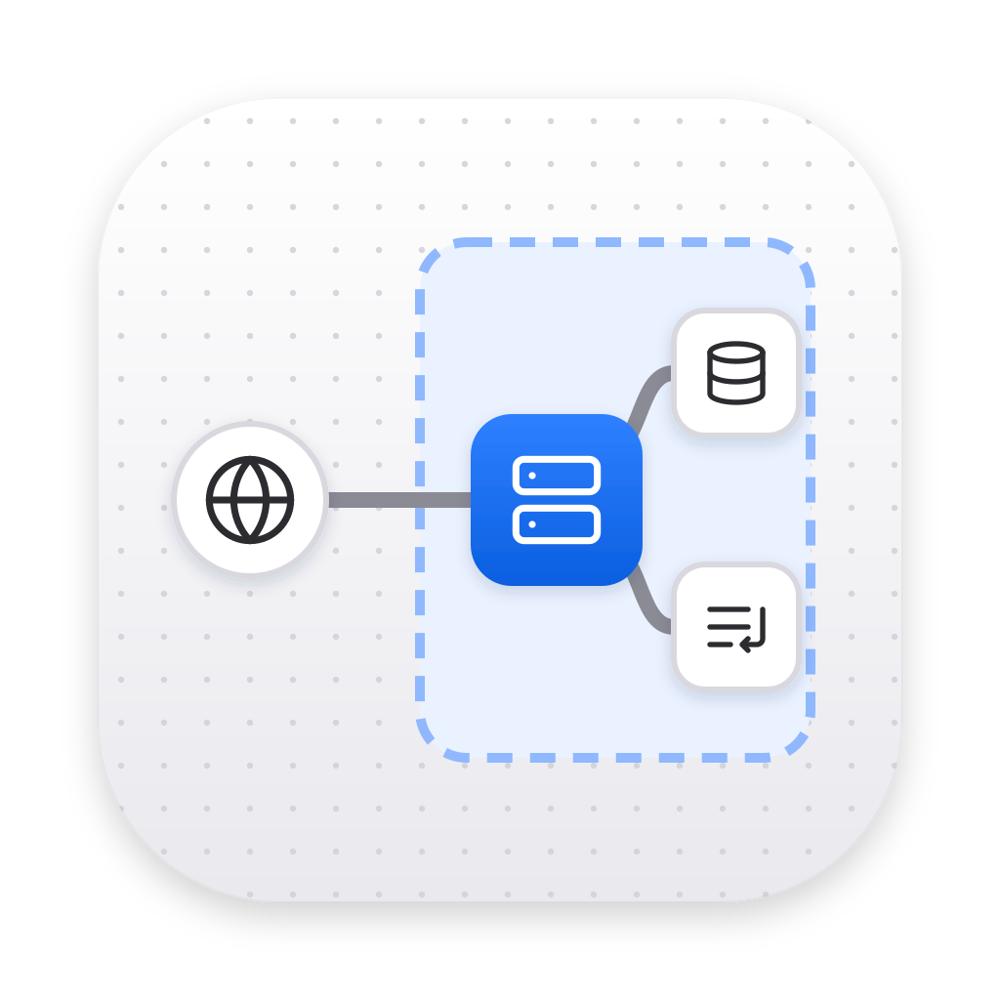

# System Designer

App nativa de macOS para dibujar diagramas de **diseño de sistemas** con componentes genéricos (servidor, cola, bucket, base de datos SQL, CDN, clientes web/móvil…), construida sobre la plantilla [mac-app-template](https://github.com/leonardoramirezr/mac-app-template): Swift + AppKit, sin proyecto de Xcode.

Cada acción en la interfaz modifica un diagrama **Mermaid** y el render se actualiza; los elementos no se mueven a mano, el layout es automático.



## Funciones

- **Lienzo infinito**: arrastra para moverte, desplaza con dos dedos, pellizca (o ⌘ + scroll) para hacer zoom. La vista por defecto centra el diagrama con el zoom que permite verlo completo (⌘0); lo que construyes crece desde el centro.
- **Componentes con ícono** (íconos [Lucide](https://lucide.dev)): clientes (Web, Móvil, Frontend, Escritorio, Usuario, IoT), cómputo, red, datos, mensajería y plataforma — más de 40 tipos.
- **Añadir a la izquierda o a la derecha**: al seleccionar un componente aparecen botones **+** a cada lado (o `Tab` / `⇧Tab`). El nuevo componente queda conectado.
- **Título y descripción** por componente (y por grupo), visibles en el diagrama.
- **Texto en las líneas**: `A -->|"llama"| B`, con estilo sólido, punteado (asíncrono) o grueso, y flecha simple, doble o sin flecha.
- **Grupos visuales** (“Nube de AWS”, “VPN interna”, regiones, clústeres, zonas seguras…): rectángulos detrás de los componentes que en el código son `subgraph`, anidables. Selecciona varios componentes con `⇧ clic` y pulsa **Grupo** (⌘G).
- **Biblioteca interna** con guardado automático, renombrar, duplicar y eliminar (los eliminados van a la Papelera).
- **Exportar / importar `.sdll`** (y exportar SVG). Los `.sdll` se abren con doble clic desde Finder.
- **Editor Mermaid**: la barra lateral muestra el archivo `.sdll` en vivo; puedes editarlo y aplicar los cambios.
- **IA** con cualquier API compatible con OpenAI — Groq, OpenAI, [Itera Compute](https://api.iteracompute.com/v1/chat/completions) o un servidor propio (Ollama, LM Studio, vLLM). Un *segmented control* elige el modo:
  - **Generar**: crea o modifica el diagrama a partir de una descripción (se puede deshacer).
  - **Feedback**: revisa el diseño y responde preguntas, sin editar el diagrama.
- Modo claro y oscuro, deshacer/rehacer ilimitado (⌘Z / ⇧⌘Z).

## Requisitos

- macOS 15.0 o posterior
- Xcode Command Line Tools (`xcode-select --install`)

## Compilar e instalar

```sh
make build      # build/System Designer.app (arquitectura actual)
make universal  # Apple silicon + Intel
make run        # compila y abre la app
make install    # copia la app a /Applications
make test       # pruebas unitarias del formato y del parser (Node 18+)
```

`build.sh` compila `src/*.swift` con `swiftc`, arma el bundle, copia `Info.plist`, la interfaz (`web/`) y el ícono, y firma ad-hoc.

La primera vez que la IA usa una API key, macOS puede pedir permiso para leerla del Llavero (con firma ad-hoc vuelve a pedirlo tras recompilar); elige *Permitir siempre*.

## Formato `.sdll`

Un `.sdll` es texto plano: **un diagrama Mermaid válido** más una línea de metadatos en un comentario `%%` (Mermaid ignora los comentarios, así que el archivo se puede pegar tal cual en cualquier renderer de Mermaid).

```text
%% System Designer · sdll v1
%% @meta {"format":"sdll","version":1,"name":"Checkout","createdAt":"…","updatedAt":"…"}
flowchart LR
  web@{ icon: "sd:web", form: "circle", label: "Web", pos: "b", h: 46 }
  subgraph aws["AWS"]
    api@{ icon: "sd:server", form: "rounded", label: "API<br><small>REST</small>", pos: "b", h: 46 }
    db@{ icon: "sd:sql-db", form: "rounded", label: "Postgres", pos: "b", h: 46 }
  end
  web -->|"llama"| api
  api --> db
  class aws grp_cloud
  classDef grp_cloud fill:#eff6ff,stroke:#93c5fd,stroke-dasharray:5 4
```

- **Componentes**: forma de ícono de Mermaid (`id@{ icon: "sd:<tipo>", label: "…" }`). El tipo va en el nombre del ícono (`sd:server`, `sd:queue`, `sd:bucket`, `sd:sql-db`, `sd:web`, `sd:mobile`…; lista completa en [`web/js/catalog.js`](web/js/catalog.js)). La descripción va después del título dentro de `<small>`.
- **Grupos**: `subgraph id["Título"] … end`; el tipo de grupo es una clase `grp_<tipo>` (`cloud`, `network`, `region`, `cluster`, `security`, `external`).
- **Conexiones**: flechas de flowchart con texto opcional: `-->`, `-.->`, `==>`, `<-->`, `---`.
- El texto se escribe con entidades HTML (`&quot;`, `&num;`, `&ast;`…) para que nunca rompa la sintaxis.
- Al importar se acepta Mermaid *flowchart* escrito a mano o por un LLM (`A[Web] --> B[(DB)]`, `A --texto--> B`, `subgraph`, `&`, etc.); el tipo de cada componente se infiere del ícono, la forma o el texto.

## Arquitectura

```
src/                 App nativa (Swift/AppKit)
  main.swift           AppDelegate, ciclo de vida, archivos abiertos desde Finder
  MainMenu.swift       Menús (los comandos se reenvían a la interfaz)
  MainWindowController ventana + WKWebView, comandos JS, self-test de CI
  Bridge.swift         puente JS ↔ Swift (WKScriptMessageHandlerWithReply)
  DiagramStore.swift   biblioteca en ~/Library/Application Support/System Designer/Diagrams
  Keychain.swift       API keys en el Llavero
  LLMClient.swift      cliente OpenAI-compatible (/chat/completions, /models) con URLSession
web/                 Interfaz (HTML/CSS/JS sin dependencias de build), empaquetada en la app
  js/model.js          modelo y operaciones (cada acción de la UI pasa por aquí)
  js/sdll.js           serializador a Mermaid y parser tolerante
  js/render.js         Mermaid → SVG, tema, post-proceso para selección
  js/canvas.js         lienzo infinito (pan, zoom, ajustar vista)
  js/app.js            estado, historial, comandos, autoguardado
  js/inspector.js, sidebar.js, picker.js, ai.js, llm.js, settings.js
  vendor/mermaid.min.js  Mermaid 11.17.2 (MIT)
tests/               pruebas del modelo y del formato (node --test)
scripts/             build-icons.mjs (subconjunto de Lucide), fetch-vendor.sh (Mermaid)
```

El flujo siempre es: **acción en la UI → mutación del modelo → código Mermaid → render**. Mermaid se ejecuta dentro de un `WKWebView`; las peticiones a los LLM las hace Swift (no hay problemas de CORS) y las API keys nunca pasan por la página: el lado nativo las lee del Llavero y solo las envía a la URL fija de su proveedor.

### Desarrollo de la interfaz

`web/index.html` también funciona en un navegador (`make web`): sin el shell nativo, la biblioteca y las preferencias usan `localStorage`, la exportación descarga archivos y la IA usa `fetch` directo (solo con proveedores que permitan CORS, p. ej. un servidor local).

```sh
npm install        # solo herramientas de desarrollo
npm run icons      # regenera web/js/icons.js desde @iconify-json/lucide
npm run vendor     # vuelve a descargar Mermaid
```

## Atajos

| Acción | Atajo |
| --- | --- |
| Añadir componente | ⌘K |
| Añadir a la derecha / izquierda del seleccionado | Tab / ⇧Tab |
| Editar título del seleccionado | ↩ (o doble clic) |
| Seleccionar varios | ⇧ clic |
| Agrupar selección | ⌘G |
| Eliminar selección | ⌫ |
| Navegar entre componentes conectados | ← → ↑ ↓ |
| Deshacer / Rehacer | ⌘Z / ⇧⌘Z |
| Ver todo / Acercar / Alejar | ⌘0 / ⌘= / ⌘− |
| Barra lateral | ⌘B |
| Asistente de IA | ⌘J |
| Nuevo / Importar / Exportar | ⌘N / ⌘O / ⌘E |
| Ajustes de IA | ⌘, |

## Licencia

[GNU General Public License v3.0](LICENSE). Incluye Mermaid ([MIT](web/vendor/mermaid.LICENSE)) e íconos de Lucide ([ISC](web/vendor/lucide.LICENSE)).
